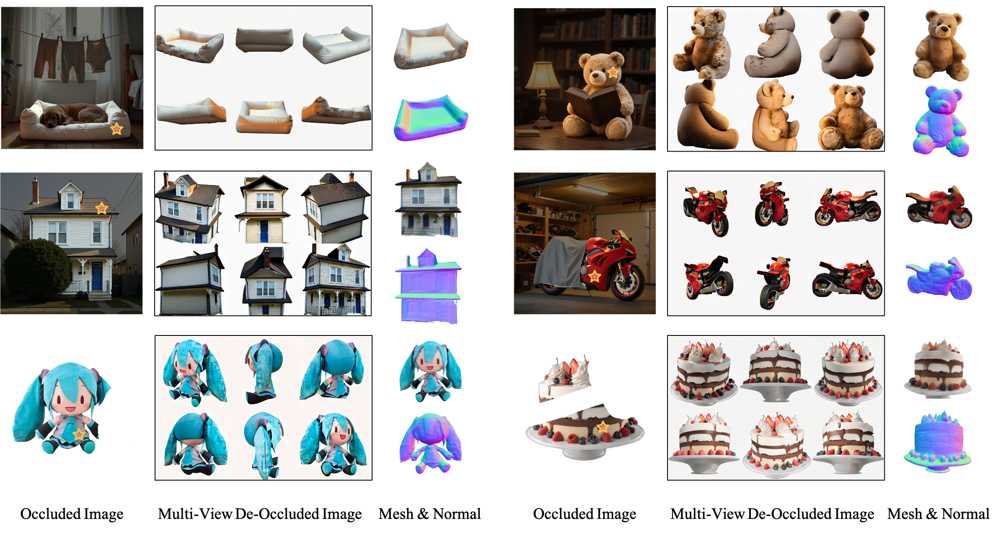

<p align="center">
  <h1 align="center"> <b>DeOcc-1-to-3</b></h1> 
</p>
  
<p align="center">
	<a href="https://arxiv.org/abs/2506.21544"></a>
	<a href='https://quyans.github.io/DeOcc123/'></a>
	<a href="https://drive.google.com/file/d/1RBACpAznCLsqt70VsYuqLAPg3rhWl2_r/view?usp=drive_link"></a> <br>
</p>

<p align="center">
  Official implementation of the paper:<br>
  <strong>“DeOcc-1-to-3: 3D De-Occlusion from a Single Image via Self-Supervised Multi-View Diffusion”</strong>
</p>

<div align="center">
  
</div>

---

## ⚡ TL;DR

**DeOcc-1-to-3** is a 3D de-occlusion framework.   
From a **single occluded image**, it synthesizes **six structure-consistent novel views**, enabling **faithful Amodal 3D reconstruction**.


## 🚀 Key Features

✅ Synthesizes **six structurally consistent novel views** from a single occluded image  
✅ **Self-supervised training** with pseudo-ground-truth views generated by a pretrained multi-view diffusion model  
✅ Seamless integration with existing 3D reconstruction pipelines (e.g., InstantMesh)  
✅ Introduces the first **benchmark for occlusion-aware 3D reconstruction**


## 🛠️ Installation

```bash
git clone https://github.com/Quyans/DeOcc123
cd DeOcc123

# create environment
conda env create -f environment.yml
conda activate deocc123

# prepare SAM model
mkdir ckpts
curl -L -o ckpts/sam_vit_h.pth https://dl.fbaipublicfiles.com/segment_anything/sam_vit_h_4b8939.pth
```

Download pretrained model weight from [Google Drive](https://drive.google.com/file/d/1RBACpAznCLsqt70VsYuqLAPg3rhWl2_r/view?usp=drive_link) and put it under the `ckpts/` directory.

## 🎆 Gradio Demo

You can quickly try out the model with our interactive Gradio demo:
```bash
python app.py
```

Here is a short video demonstrating how to use the demo:

https://github.com/user-attachments/assets/750cb886-26bf-41b6-8c25-f1845030a93c


## 📄 Citation

If you find our work useful, please cite:

```bibtex
@article{qu2025deocc,
    title={DeOcc-1-to-3: 3D De-Occlusion from a Single Image via Self-Supervised Multi-View Diffusion},
    author={Qu, Yansong and Dai, Shaohui and Li, Xinyang and Wang, Yuze and Shen, You and Cao, Liujuan and Ji, Rongrong},
    journal={arXiv preprint arXiv:2506.21544},
    year={2025}
}
```

## 🌟 Acknowledgements

Thanks to the following great repositories: 
[**Zero123++**](https://github.com/SUDO-AI-3D/zero123plus), [**InstantMesh**](https://github.com/TencentARC/InstantMesh)
